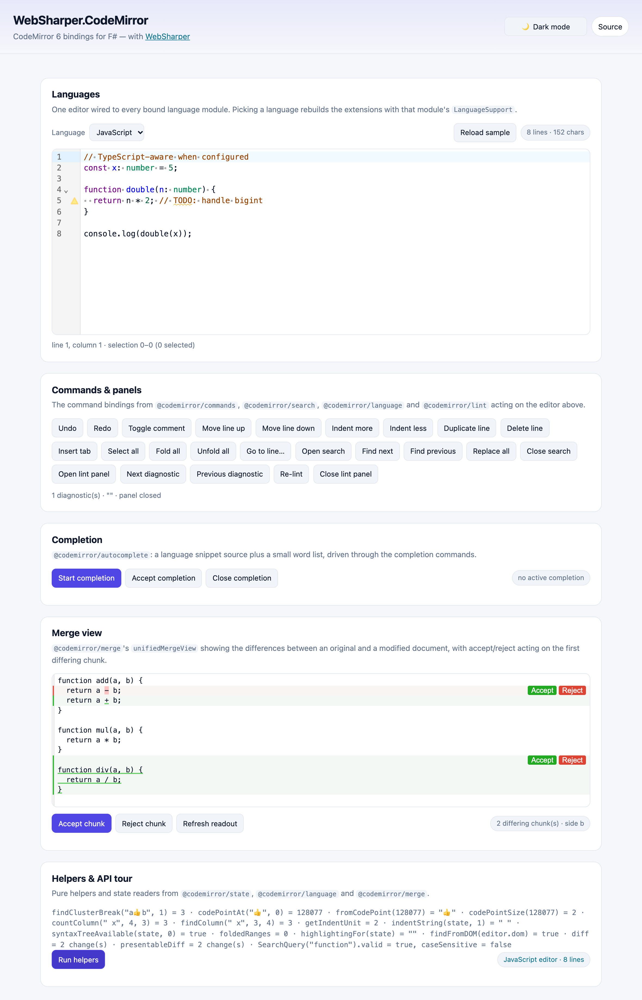

# WebSharper.CodeMirror

[](https://www.nuget.org/packages/WebSharper.CodeMirror)

WebSharper bindings for [CodeMirror 6](https://codemirror.net/6/) — the modular
code editor — for F# and C# web apps.

The binding is **npm-based**: it imports the CodeMirror packages as ES modules
(`import { EditorView, keymap } from "@codemirror/view"` and so on) and your
toolchain bundles them (the sample uses esbuild). There is no CDN `<script>` tag.

This repository contains:

| Project | Purpose |
| --- | --- |
| `WebSharper.CodeMirror` | The binding: WIG definitions for the CodeMirror core modules (`@codemirror/state`, `view`, `language`, `commands`, `search`, `autocomplete`, `lint`, `collab`, `merge`, `lsp-client`, `language-data`), the `codemirror` setup package, every `@codemirror/lang-*` mode, and `@codemirror/theme-one-dark`. |
| `WebSharper.CodeMirror.Sample` | A static WebSharper SPA (esbuild → `dist/`) that drives the binding: a language switcher across all bound modes, the command/panel surface, lint diagnostics, autocompletion, a unified merge view and the state/language helpers. |

## Bound npm packages

The binding covers these CodeMirror 6 packages (versions are the reference
release; the range allows later patch/minor releases of the same major):

**Core** — `codemirror`, `@codemirror/state`, `@codemirror/view`,
`@codemirror/language`, `@codemirror/commands`, `@codemirror/search`,
`@codemirror/autocomplete`, `@codemirror/lint`, `@codemirror/collab`,
`@codemirror/merge`, `@codemirror/lsp-client`, `@codemirror/language-data`.

**Language modes** — `@codemirror/lang-angular`, `lang-cpp`, `lang-css`,
`lang-go`, `lang-html`, `lang-java`, `lang-javascript`, `lang-jinja`,
`lang-json`, `lang-less`, `lang-lezer`, `lang-liquid`, `lang-markdown`,
`lang-php`, `lang-python`, `lang-rust`, `lang-sass`, `lang-sql`, `lang-vue`,
`lang-wast`, `lang-xml`, `lang-yaml`.

**Themes** — `@codemirror/theme-one-dark`.

## Live demos

**Try it live:** [Open the sample in your browser](https://dotnet-websharper.github.io/codemirror/)



The sample doubles as the binding's [test case](#running-the-test-case): it
switches between every bound language module, runs the command/keymap/panel
surface (`undo`/`redo`, comment toggling, line moves, folding, go-to-line, the
search panel, the lint panel), shows `linter` diagnostics and an
`autocompletion` override, drives a `unifiedMergeView` with accept/reject, and
prints the `state`/`language`/`merge` helpers. It is light-themed by default and
has a light/dark theme switcher (persisted in `localStorage`).

- **Sample (this repository):** <https://dotnet-websharper.github.io/codemirror/>
- **Source repository:** <https://github.com/dotnet-websharper/codemirror>
- **WebSharper bindings:** <https://websharper.com/bindings>

## Install

```bash
dotnet add package WebSharper.CodeMirror
```

Or with Paket:

```fsharp
nuget WebSharper.CodeMirror
```

The package targets `netstandard2.0` and works with any WebSharper 10 or 11
project. It declares its npm dependencies (`codemirror` `>= 6.0.2 < 7.0.0` and
the `@codemirror/*` packages it uses), so WebSharper's SPA/esbuild build pulls
them in automatically.

## Usage

All types live in the `WebSharper.CodeMirror` namespace. Module functions are
static members of `CodeMirror`; the editor is `EditorView`, configured with an
`EditorViewConfig`.

```fsharp
open WebSharper.JavaScript
open WebSharper.CodeMirror

let view =
    EditorView(
        EditorViewConfig(
            Doc = "const x = 1;",
            Parent = JS.Document.Body,
            Extensions =
                [|
                    CodeMirror.BasicSetup
                    CodeMirror.Javascript(JavaScriptConfig(Typescript = true))
                    CodeMirror.OneDark
                |]))
```

`BasicSetup` and `MinimalSetup` come from the `codemirror` package; every other
extension is a static on `CodeMirror` (e.g. `CodeMirror.LineNumbers()`,
`CodeMirror.Keymap.Of(...)`, `CodeMirror.Linter(source)`).

### Commands and state

`@codemirror/commands` and `@codemirror/search` commands are bound as their real
shapes: `Command` is `EditorView -> bool`, `StateCommand` is
`StateCommandTarget -> bool`.

```fsharp
// A state command needs a target that knows how to dispatch.
let target = StateCommandTarget(view.State, fun (tr: Transaction) -> view.Dispatch(tr))
CodeMirror.ToggleComment(target) |> ignore

// View commands take the view directly.
CodeMirror.OpenSearchPanel(view) |> ignore
```

### Linting and autocompletion

```fsharp
let lintSource (v: EditorView) =
    [| Diagnostic(0, 4, Severity.Warning, "TODO marker", Source = "sample") |]

let extensions = [|
    CodeMirror.Linter(lintSource)
    CodeMirror.LintGutter()
    CodeMirror.Autocompletion(
        CompletionConfig(
            ActivateOnTyping = true,
            Override = [| As (CodeMirror.CompleteFromList([| "let"; "match" |])) |]))
|]
```

### Merge view

```fsharp
let view =
    EditorView(
        EditorViewConfig(
            Doc = modified,
            Parent = host,
            Extensions = [|
                CodeMirror.MinimalSetup
                CodeMirror.UnifiedMergeView(
                    UnifiedMergeConfig(original, HighlightChanges = true, Gutter = true))
            |]))

CodeMirror.AcceptChunk(view) |> ignore   // or AcceptChunk(view, position)
```

### Dynamic configuration

```fsharp
let theme = Compartment()
view.Dispatch(TransactionSpec(Effects = theme.Reconfigure(CodeMirror.OneDark)))
```

## Notes on the API

- **Configuration objects use named arguments.** All-optional configs are built
  with named fields (`EditorViewConfig(Doc = ..., Extensions = ...)`); configs
  with required fields take those positionally, then the optional fields by name
  (`Diagnostic(0, 4, Severity.Warning, "msg", Source = "sample")`).
- **`=?` members are facets/effects/values, not functions.** Use a facet with
  `.Of(...)` (e.g. `EditorState.AllowMultipleSelections.Of(true)`,
  `CodeMirror.Keymap.Of([| CodeMirror.IndentWithTab |])`), and an effect type
  with `.Of(...)` (e.g. `CodeMirror.SetSearchQuery.Of(query)`).
- **`EditorView.LineWrappingStatic` is `EditorView.lineWrapping`.** The .NET name
  avoids clashing with the instance `LineWrapping` member.
- **Diagnostics and severities** are `Diagnostic` and `Severity`; severities are
  `Severity.Hint`, `Severity.Info`, `Severity.Warning`, `Severity.Error`.
- **The merge helpers (`AcceptChunk`, `RejectChunk`, `GetChunks`) need a
  `unifiedMergeView`**, not the side-by-side `MergeView` class — the latter keeps
  its diff state in its own fields.
- **`@codemirror/collab` and `@codemirror/lsp-client` are transport-agnostic.**
  You supply the sync transport / `Transport` callbacks; the sample does not
  exercise them because they need a server.

## Running the test case

The sample is a static SPA. Building it runs `npm install` and esbuild and emits
`dist/` at the repository root:

```bash
dotnet build WebSharper.CodeMirror.Sample/WebSharper.CodeMirror.Sample.fsproj -c Release
dotnet serve -d dist -p 8080
```

`dotnet serve` comes from the [`dotnet-serve`](https://github.com/dotnet-serve/dotnet-serve)
tool; install it once with `dotnet tool install -g dotnet-serve` (or use
`dotnet tool run dotnet-serve` with a local tool manifest).

Open <http://localhost:8080/>. CodeMirror and every language mode are bundled,
so no network access is needed. Use the language picker, the toolbar buttons and
the theme switcher to verify a change end to end.

## Building from source

### Prerequisites

- [.NET SDK 10](https://dotnet.microsoft.com/download) or later (the WebSharper
  11 compiler runs on .NET 11, which is installed by the CI).
- [Node.js](https://nodejs.org/) (for the sample's esbuild step).
- [Paket](https://fsprojects.github.io/Paket/) as a local dotnet tool (configured
  in `.config/dotnet-tools.json`).

### Restore and build

```bash
dotnet tool restore
dotnet paket restore
dotnet build WebSharper.CodeMirror.sln -c Release
```

The binding targets `netstandard2.0`; the sample is a static bundle. You can also
drive everything through the FAKE script:

```bash
./build            # Debug build of the solution
./build CI-Release # the build stack's target
```

### Pack the NuGet package

After a Release build (so the assemblies and `.websharper` sidecars exist in
`bin/Release/netstandard2.0`):

```bash
WSPackageFolder=./out ./build WS-Package
```

## Deployment

Pushing to the default branch triggers `.github/workflows/ghpages.yml`, which
restores via Paket, builds the sample in Release and publishes `dist/` to the
`gh-pages` branch for GitHub Pages.

## Repository layout

```
WebSharper.CodeMirror/            # the binding (WIG definitions)
  CodeMirrorState.fs              # @codemirror/state
  CodeMirrorView.fs               # @codemirror/view
  CodeMirrorLanguage.fs           # @codemirror/language
  CodeMirrorCommand.fs            # @codemirror/commands
  CodeMirrorSearch.fs             # @codemirror/search
  CodeMirrorAutoComplete.fs       # @codemirror/autocomplete
  CodeMirrorLint.fs               # @codemirror/lint
  CodeMirrorCollab.fs             # @codemirror/collab
  CodeMirrorMerge.fs              # @codemirror/merge
  CodeMirrorLspClient.fs          # @codemirror/lsp-client
  CodeMirrorLang{SQL,Html,Xml}.fs # language config types
  Main.fs                         # the CodeMirror class + assembly
WebSharper.CodeMirror.Sample/     # static SPA demo / test case
  Client.fs
  index.html
  site.css
  esbuild.config.mjs
  wsconfig.json
docs/
  sample.png                      # screenshot of the running sample
nuget/                            # Paket pack template
.github/workflows/ghpages.yml     # build + deploy the sample
```

## License

Apache 2.0 — see [LICENSE.md](LICENSE.md).
